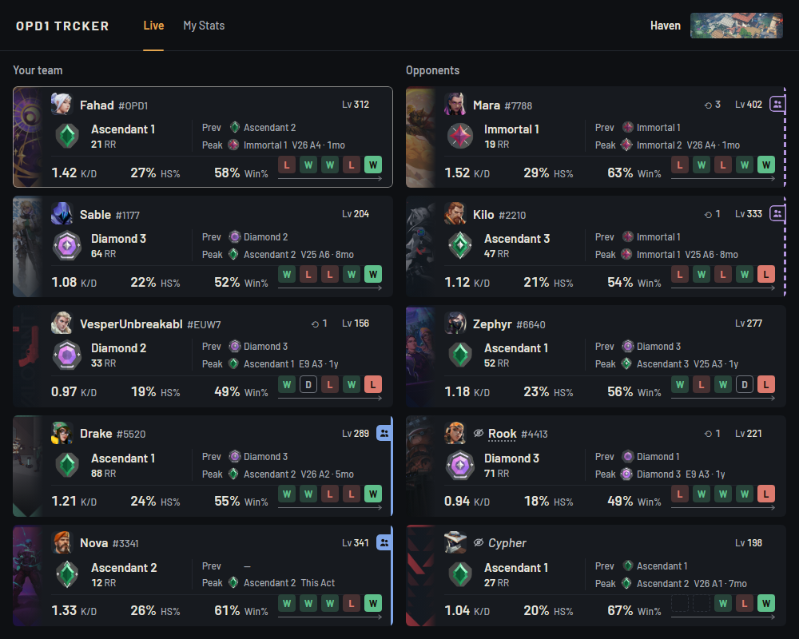
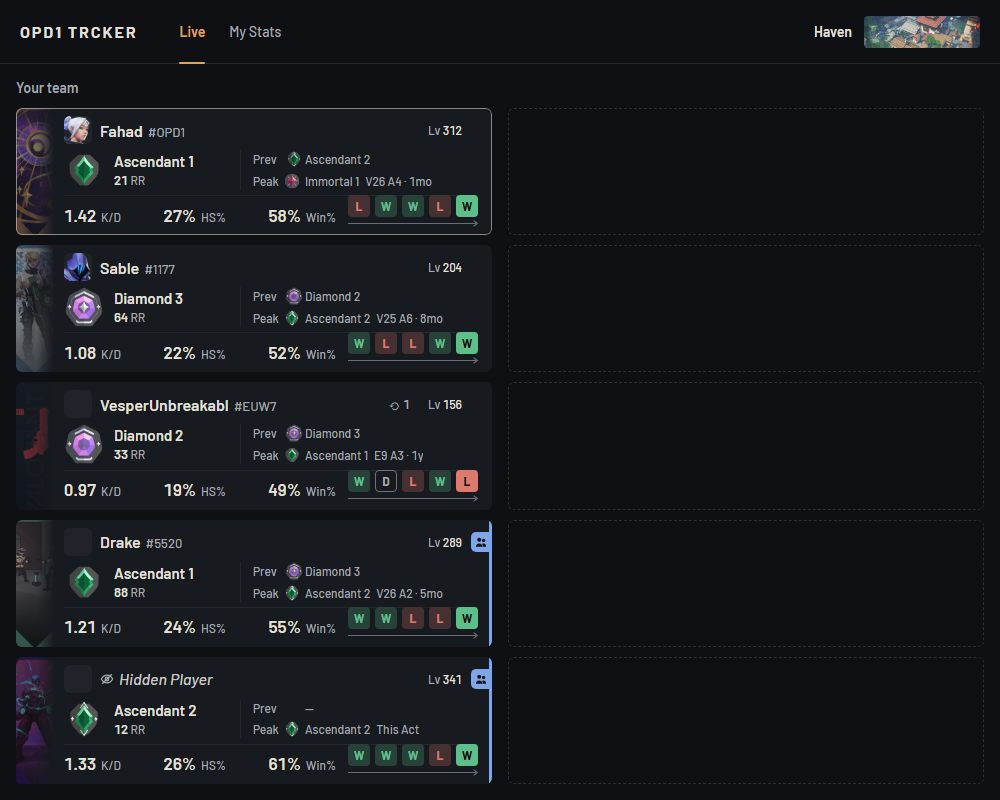
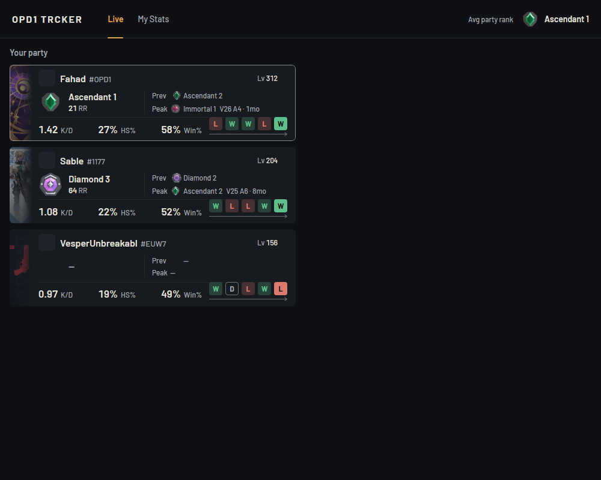
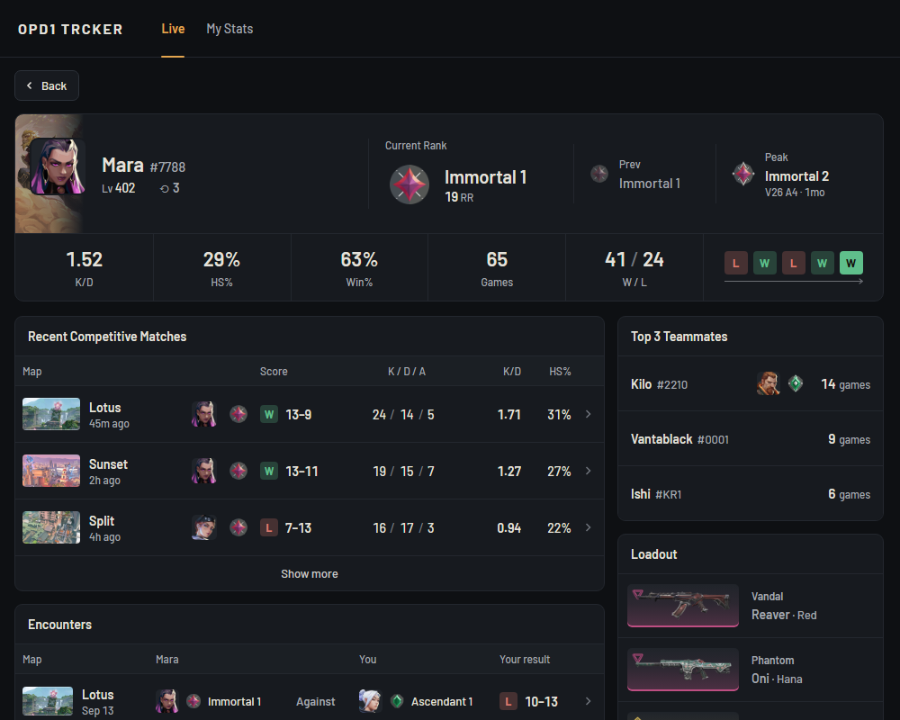
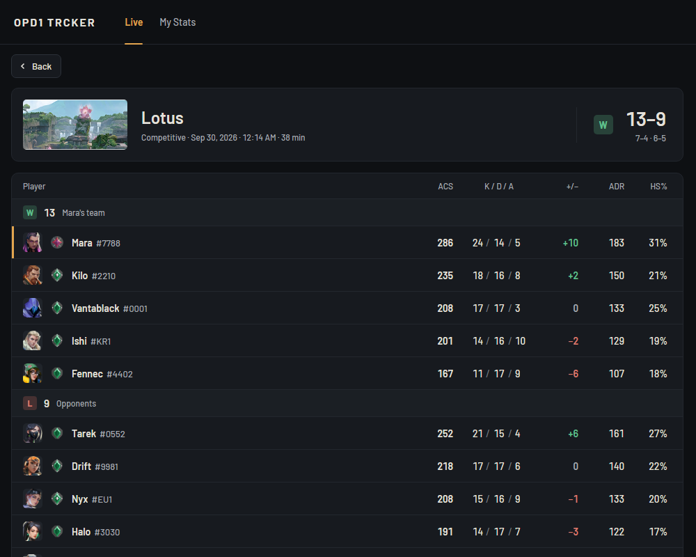
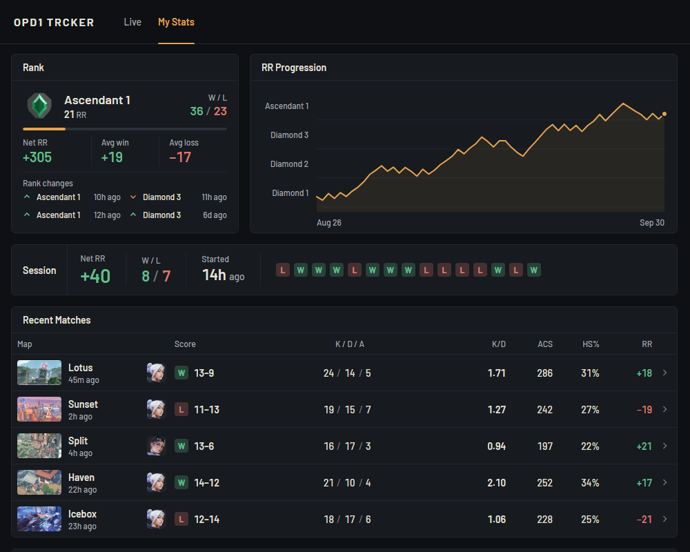

# OPD1 TRCKER

A very light Windows desktop tracker for VALORANT. It reads the **local Riot client API** and shows live Lobby, Agent Select and In Game player cards, plus your own deep competitive stats. Everything stays on your PC.

The name is spelled `OPD1 TRCKER` on purpose.

## Screenshots

| | |
|---|---|
|  |  |
|  |  |
|  |  |

## Features

- **One Live page** for all three stages. Lobby shows you and your party, Agent Select shows your team with five empty slots for the other side, and In Game shows both teams with the map. No scrolling.
- **Player card** in every stage: Player Card image, Riot ID with a distinct tag, account level, current rank with exact RR, previous act rank, peak rank with the act it was reached in, K/D and HS% from the last 5 competitive matches, current-act win rate, and the last 5 results. Extra detail is in hover tips.
- **Hidden names** are respected. Only the Riot ID and tag are hidden (`Hidden Player`, then the agent name once locked). The app never asks for a hidden player's name.
- **Party detection** on both teams from recent matches, shown as a coloured stripe (dashed for likely, solid for confirmed).
- **Encounters**: how many past matches you shared with a player, with or against.
- **Player Details** (click any card): recent competitive matches, top 3 teammates this act, loadout, and your history with that player.
- **Match Details**: the full scoreboard of a match.
- **My Stats**: your own act at a glance: rank, RR, W / L and the RR to the next tier, the RR chart, the current session, your last 5 competitive matches, Maps and Agents tables, win rate by weekday and time of day, and automatic insights. With VALORANT closed the app opens here.
- **Local memory**: every player and match is stored once in SQLite, so the app only fetches what is new and shows saved data when VALORANT is closed.
- Fixed 1000×800 window, always on top. Close quits. No tray, no autostart, no auto-updater.

## Install (for friends)

1. Download `OPD1-TRCKER-<version>-setup.exe` from the repo's GitHub Releases page (each release keeps its installer for good; a `main` build also leaves it as an Actions artifact for 90 days). The repo is private and the installer is shared by hand, so you normally get it from the person who runs the project.
2. Run the installer. The build is unsigned, so on the Windows SmartScreen screen click **More info**, then **Run anyway**.
3. It installs per user (no administrator rights needed).
4. A reinstall or an update keeps your history. The uninstaller has an optional **Delete app data** checkbox (off by default) that removes it.

The app needs the WebView2 runtime, which Windows 11 and an up-to-date Windows 10 already include.

## Build from source

### Interactive design review

After `npm ci`, run `npm --prefix ui run dev -- --port 4173 --strictPort` and open [the local design review](http://127.0.0.1:4173/design.html). Switch sample screens, stress cases and appearance options without changing the fixed app layout. The review controls and mock clock are development-only and excluded from the production build. The current design and critique ledger are in [`docs/redesign.md`](docs/redesign.md).

**Windows:** Rust stable, Node 24 and WebView2, then

```bash
npm ci
npx tauri build
```

**Linux (development):** install `libwebkit2gtk-4.1-dev libsoup-3.0-dev librsvg2-dev`, then

```bash
npm ci
npm --prefix ui run dev      # the UI in a browser; DEV demo scenes with ?scene=<name>
npm --prefix ui run build    # the Rust crate needs ui/dist to exist
cargo test -p opd1-core -p opd1-riot -p opd1-trcker
npm --prefix ui run test
npm --prefix ui run check
(cd ui && npx playwright test)   # layout, tooltip and navigation checks at 1000×800 (also run by CI on Linux)
```

Anything that talks to the real Riot client can only be verified on Windows with VALORANT installed. Press Ctrl+Shift+L in the app to copy its log. Ctrl+Shift+D writes the redacted raw Riot answers to a folder, and that dump now includes `log.txt` and the error body of each failed call.

## Project structure

```text
crates/core/   opd1-core  — pure logic: parsers, card model, hidden names, party detection, stats, SQLite schema
crates/riot/   opd1-riot  — throttled Riot + valorant-api HTTP, session, asset cache
src-tauri/     opd1-trcker — Tauri shell: poll loop, roster, sync, commands, img:// scheme
ui/            Svelte 5 + Vite single-page UI
docs/          spec, plan, decisions, architecture, design spec
```

See [`docs/ARCHITECTURE.md`](docs/ARCHITECTURE.md) for how the parts fit together, [`docs/DECISIONS.md`](docs/DECISIONS.md) for every ruling, and [`docs/design-spec.md`](docs/design-spec.md) for the UI build spec.

## Stack

Tauri 2 (system WebView2) · Rust core (all Riot and valorant-api HTTP, polling, caching) · Svelte 5 + Vite SPA · SQLite through `rusqlite` (bundled). Rust pushes state to the UI with Tauri events; the UI never polls Riot. No Python, no Electron, no React.

## Status and roadmap

The scope of v0.3.1: the Live page (Lobby, Agent Select, In Game), Player Details, Match Details and My Stats, with the design options at their defaults. Next (picked by the user for v0.4.0): a History tab, a Settings tab, private player notes, a hide hotkey and a richer encounter tooltip; see `docs/next-session-prompt.md`.

## Privacy

Local only. The app talks to the Riot client on your PC, to Riot's game servers with your own session (the same calls the game makes), and to valorant-api.com for names and images. It has no account system, no telemetry and no server of its own. It never requests the name of a player who hides their identity.

## Licence

Proprietary. See [`LICENSE`](LICENSE). Third-party notices are in [`THIRD-PARTY-NOTICES.md`](THIRD-PARTY-NOTICES.md).

## Disclaimer

OPD1 TRCKER is not endorsed by Riot Games and doesn't reflect the views or opinions of Riot Games or anyone officially involved in producing or managing Riot Games properties. Riot Games and all associated properties are trademarks or registered trademarks of Riot Games, Inc.
