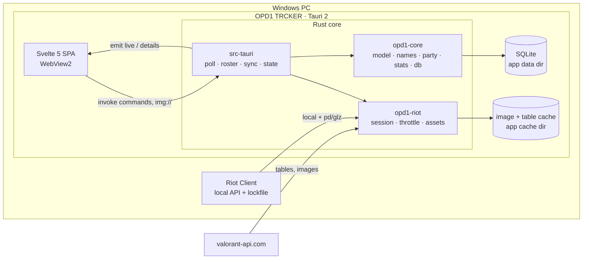

# Architecture

OPD1 TRCKER reads the local Riot client API and shows live Lobby / Agent Select / In Game player cards, plus the user's own competitive stats. Lightness is priority #1 (RAM, CPU, bundle size, request count); design is #2.

Facts on this page come from the code on `main` for v0.2.0 (Phase 2): Match Details, migration 2, the user's own loadout, the own-history backfill, lock-only agent names (R99) and the own card's level (R100). An interactive diagram of the same system is in [`docs/architecture.html`](architecture.html).

- Product rules: [`CLAUDE.md`](../CLAUDE.md). Every ruling and its status: [`DECISIONS.md`](DECISIONS.md). Build spec for the UI: [`design-spec.md`](design-spec.md).

## Shape of the system



The UI never polls Riot. Rust pushes state with Tauri events, and the UI pulls on demand through commands.

## Crates and responsibilities

| Package (dir) | Owns | Depends on |
|---|---|---|
| `opd1-core` (`crates/core`) | Pure logic, no Tauri and no HTTP, so it is unit-tested on Linux. `lockfile`, `shards` (region from `ShooterGame.log`), `presence` (decode the `/chat/v4/presences` private blob, `Stage`), `model` (wire types `LiveState`, `PlayerCard`, `PlayerDetails`, `build_card`), `names` (`display_name`, hidden-name precedence), `party` (`detect_parties`), `stats` (K/D, HS%, win rate, peak, act labels), `mystats` (My Stats aggregation), `db` (schema, versioned migrations, `Repo`). | `rusqlite` (bundled), `serde` |
| `opd1-riot` (`crates/riot`) | All Riot and valorant-api HTTP. `session::RiotSession` (lockfile, local auth, entitlements, remote headers, re-auth on 401/403, `ClientGone`), `throttle` (token bucket), `endpoints` (typed wrappers + `VisiblePuuid`), `assets` (valorant-api tables and the on-disk image cache), `to_core` (Riot responses to core types), `raw_capture` (for `dump_raw`). | `opd1-core`, `reqwest` (rustls with the `ring` provider, no http3) |
| `opd1-trcker` (`src-tauri`) | The Tauri shell and the app's brain. `poll` (stage machine), `roster` (who is on screen), `sync` (per-player cached-first sync and the background worker), `state` (`AppState`, live model, `publish`), `store` (DB glue), `details` (Player Details), `match_details` (the Match Details command's logic), `commands`, `imgproto` (the `img://` scheme), `logbuf` (ring-buffer log). | both crates, `tauri` |
| `opd1-trcker-ui` (`ui`) | The Svelte 5 + Vite SPA. Its only runtime dependency is `@tauri-apps/api`. | none of the Rust |

## Data flow

The live pipeline is one Tokio task (`poll::start`, launched in `setup`). Its states and transitions:

```text
Disconnected  ── lockfile present → RiotSession::connect (fail → back off 5s…60s) ──► Connected
Connected     ── local presence every 2s (5s while VALORANT is closed)
                 own VALORANT presence absent twice → stage Closed (own card from the DB)
                 sessionLoopState / queueId change → plan_transition()
                    MENUS   → party roster (re-fetched when partyId / partySize change)
                    PREGAME → ally team   (re-polled every 3s only to pick up agent selections, R39)
                    INGAME  → both teams + loadouts
                    PREGAME / INGAME in a free-for-all queue → stays MENUS (R41)
                    INGAME → MENUS = match end: back to Lobby + post-match follow-up
              ── ClientGone / 5 presence errors / VALORANT relaunched under a game-less session ──► Disconnected
```

1. **Poll stage machine (`poll.rs`).** With the lockfile missing, the only idle work is one file check every 5s. A connected session reads the local presence and derives the stage. A stage change fetches the roster (`pregame`, `core-game`, `parties`). A failed roster fetch never leaves the previous stage's players on screen: the new stage is emitted at once with only the user's own card, and the fetch retries with back-off.
2. **Cached-first cards.** `apply_roster` builds every card from the DB first, so the screen fills immediately. Fields still loading are absent on the wire (the UI draws a skeleton); missing values are `null` (the UI shows `—`) (R23).
3. **Background worker (`sync::run_worker`).** It walks the roster in order (self, party, allies, enemies), syncs one player at a time (see below), and re-publishes after each player.
4. **`AppState::publish` → `emit("live")`.** It rebuilds `LiveState` and emits `"live"` only when the serialized bytes differ from the last emission. Build, compare and emit happen under one lock, so events leave in the order the states were built, and an older snapshot can never land after a newer one.
5. **`"details"` event.** `player_details` returns what is cached at once (card, recent matches, top teammates, loadout, encounters). It then syncs that player in the background and emits `"details"` if it found more.
6. **Post-match.** When a match ends, follow-up checks at +30s and +90s look at `competitiveupdates` (not the match list) so the rank and RR refresh in the Lobby (R48).

## Commands

Registered in `src-tauri/src/lib.rs`, implemented in `commands.rs`:

| Command | Returns |
|---|---|
| `meta` | Agents, maps, tiers and acts from valorant-api (names and colours), fetched once per app start |
| `live_state` | The current `LiveState` (the UI's first snapshot; later ones arrive as `"live"` events) |
| `player_details` | `PlayerDetails` for one puuid, then a possible `"details"` event |
| `my_stats` | `Option<MyStats>` for the user's own account and the current act (`null` until the user and the act are known) |
| `match_details` | `MatchDetailsView` for `(matchId, focusPuuid)`: one match as the Match Details scoreboard (ACS, K/D/A, +/−, ADR, HS%, half scores, each player's rank during the match). Both ids must be uuids. It reads the stored match; a match the DB doesn't have is fetched once from match-details (through the session's throttle), stored like every match, and read again. `Err("unknown match")` when it still isn't there (no session, the fetch failed). Names follow the hidden-name rules below (R74, R93) |
| `copy_log` | The last 500 log lines. The UI writes them to the clipboard with `navigator.clipboard` on Ctrl+Shift+L (bound in `App.svelte`, decided by `keyAction` in `ui/src/lib/boot.ts`, only inside the Tauri shell), so there is no clipboard plugin (R30) |
| `dump_raw` | Writes the redacted raw Riot responses to `debug/` in the app data dir, for fixtures (Ctrl+Shift+D, bound the same way). The dump keeps one body per endpoint, so `match_details.json` is only the last match-details fetched, and `player_loadout.json` is the user's own loadout (R90) |

## Database

SQLite through `rusqlite` (bundled), in the app data dir (`%APPDATA%\com.opd1.trcker\data\opd1.sqlite` on Windows), WAL mode.

- **Schema.** Migration 1 (`crates/core/src/db/schema.sql`) creates `players`, `matches`, `match_teams`, `match_players`, `history_index`, `comp_updates`, `mmr_snapshots` and `app_state`. Migration 2 (`migration2.sql`, R89) adds four nullable columns for Match Details: `matches.game_length_ms`, `match_teams.rounds_won_h1` (first-half rounds, filled only for the queues with 12-round halves), `match_players.competitive_tier` (the player's rank during the match, R81) and `match_players.damage` (ADR is this over the rounds played). They are `NULL` on rows stored before migration 2. Match details are stored as compact rows (about 1–2 KB per match), never raw JSON.
- **Migrations.** `db::open_db` applies the entries of `MIGRATIONS` that `PRAGMA user_version` has not seen yet, each in a transaction, and stores the new `user_version` (2 at v0.2.0). An install from v0.1.0 has run migration 1 and takes only migration 2. Every change is a new entry appended to the list. Existing entries are frozen, migration 1 included (R89: the `migration1_is_frozen` test fails if `schema.sql` is edited), and there is no self-heal code. The next schema change is migration 3.
- **`app_state`.** A key/value table for small facts the app keeps between runs. Three kinds of key matter here. `self_loadout` is the user's own last-read loadout (R90); it is deleted when a different account connects, so one account's copy never shows for another. `self_history_anchor:{puuid}` is the own-history backfill's anchor (R101) and `self_history_failures:{puuid}` its per-match failure counts (R137, R139). Both are one key per account and are never deleted on an account switch, so switching back finds the first account's anchor again. The pre-R137 single key `self_history_anchor` is no longer read.
- **Keys.** Players are keyed by PUUID, so they are recognised after a name change. Match details are immutable: fetched once, kept forever.
- **Retention.** Keep everything. The DB is the app's memory and survives reinstalls. Only the uninstaller's optional "Delete app data" removes it.

### The user's own loadout (R90)

Another player's skins are readable only from the current match (core-game In Game, pre-game for Agent Select allies), so the Lobby and Closed stages have no source for them. The user's own are different: once per connect, at the first presence that shows VALORANT running (`read_self_loadout_once`), the poll loop spawns `sync::fetch_self_loadout`, one read-only `GET pd .../personalization/v2/players/{self}/playerloadout` (always the user's own puuid). The four skins (Vandal, Phantom, Operator, Sheriff, in the equipped chroma) are kept in `live.self_loadout` and, only when they changed, in `app_state` under `self_loadout`. At startup the stored copy is restored into `live.self_loadout`, so the user's own Player Details shows their skins while VALORANT is closed. `details::raw_loadout` prefers the match's loadout (the freshest) and falls back to this copy. A connect that never sees VALORANT (the Riot Client alone) asks nothing, and a failure is logged and not retried until the next connect. Skin names come from valorant-api one skin at a time (`/v1/weapons/skins/{uuid}`, never the 3.5 MB `/v1/weapons` table) and the content-tier badges from `/v1/contenttiers`.

### The own-history backfill (R101)

The app was closed while the user played, and Player Details, Encounters and My Stats need those matches, so the user's own history is caught up in the background. It is the lowest-priority job of the sync worker: `LiveModel::next_job` hands out `Names`, then `Sync` (live cards), and `Backfill` only when neither is pending. A step yields as soon as a live job appears, and the run's cursor stays in memory.

- **Trigger.** `sync::start_backfill_run` on connect and again when a match ends (INGAME to MENUS). It is a no-op while a run is active, so a second trigger keeps its cursor. On connect only the run is queued; the worker starts once VALORANT is running, so a Closed start makes no calls (R137).
- **Never during a match.** `LiveModel::backfill_ready` allows a run only in the Lobby or Closed stage and only while the raw presence says no match is on (`in_match`). Agent Select, In Game and a free-for-all match (whose view stays the Lobby, R41) all pause it, and a worker that claimed the job just before a match starts hands it back. The cursor waits in memory and resumes after the match.
- **Walk.** Pages of 20 (`BACKFILL_PAGE`) of the user's match history, any queue. Each page is indexed into `history_index`, and match-details is fetched one at a time (through the throttle) only for ids the DB doesn't know. A match Riot no longer has (404) is skipped at once. Any other failure, a decode error included, ends the run without moving the anchor, so the gap is retried next time. A failure that says something about the id itself (a status other than 401, 403, 404 and 429, or a body that doesn't decode) is counted in `self_history_failures:{puuid}`, and after 3 runs in a row ending at the same id it is skipped and logged. Rate-limit, network and auth errors end the run without counting, so an outage never skips ids for good (R139).
- **Stops.** With an anchor: the anchor's match id, or the first entry older than the anchor's start. First run, no anchor: the start of the current act, or 200 entries (`BACKFILL_FIRST_RUN_MAX`), whichever comes first.
- **Anchor.** When a run finishes with everything stored, the newest entry page 0 showed is written to `app_state` as `self_history_anchor:{puuid}` (`{"matchId", "startMs"}`) and that account's failure counts are cleared. The key belongs to the account that ran, so an account switch can neither delete an anchor nor let one account's anchor bound another's run (R137).

## Caching and sync ("sync, don't refetch")

Per player, `sync::sync_player` does, in order:

1. `comp_updates(0..5)`: one MMR-bucket call gives the last 5 competitive match ids and their RR changes.
2. `match_history(0..2)` in any queue: each player's last two matches, for party detection.
3. `match_details` only for ids not already in the DB (immutable, so never refetched), with at most 4 in flight (`DETAILS_CONCURRENCY`).
4. `mmr` only when `needs_mmr_refresh` says a new competitive match exists. No new competitive match means the rank cannot have changed, so the call is skipped (the MMR gate).

A failure other than `ClientGone` is logged and skipped: the fields it would have filled become `—`, never a stuck skeleton. `ClientGone` aborts the run and the poll loop notices the disconnect on its own next tick.

Assets come from valorant-api. The tables (agents, tiers, maps, seasons, chromas, cards) are re-downloaded only when `/v1/version` changes, and images are downloaded once and cached on disk (re-encoded to PNG).

## Party detection

`opd1_core::party::detect_parties` (R53, R55) uses each player's last two matches in any mode, Deathmatch included, straight from the DB with no extra requests.

- Two players on the same team whose most recent match is the same match are a **likely** party (Deathmatch has no teams, so the same match is enough).
- The link is **confirmed** when both last matches are shared, or when the shared most recent match gives both the same non-empty `partyId`.
- Links are transitive (A–B plus B–C is one group), and a group is confirmed only if every link inside it is.
- The user and their own party are excluded entirely, including as a bridge. Opposite teams in the current match are never linked. Marks come only from history synced in this session, so a stripe can appear a few seconds after its card.

## Hidden names

Rules in `CLAUDE.md` "Hidden names". How the code enforces them in v0.2.0.

- **Type-level guard (R16).** `endpoints::names()` accepts only `VisiblePuuid`, a newtype built from `(puuid, incognito = false)`. A hidden player's name cannot be requested by construction.
- **Precedence (`names::display_name`).** Visible, else the remembered name, else the agent name, else `Hidden Player`. Remembered names are learned only from finished matches the user played, and never from another player's history (R18). An agent counts as shown only once it is locked (`model::shown_agent`: `CharacterSelectionState == "locked"`, R99), so a hover shows nothing. Core-game players have no such field and are passed as `"locked"` by the roster code.
- **The user's own card** shows the user's own name from the local `/chat/v1/session` and never goes to name-service (R43, R49). Other players with `HideAccountLevel` (or a level of 0) show `Lv —`, but the own card always shows the user's own level (R100, `state.rs`: the flag is ignored for the user).
- **Match Details (R74, R93).** `opd1_core::matchview::build_match_view` picks each row's name in this order: the user's own name; a puuid hidden on the live screen now shows as its card does (the remembered name from `Repo::known_name`, which reads only matches the user played, else the agent name, else `Hidden Player`), in every view; otherwise a stored name as match-details gave it; a row with no stored name gets the hidden-style result. Match-details has no incognito flag, so in a match the user did not play a real stored name would show as is. The first real test checks whether Riot hides those names (R94).

## The `img://` scheme and throttling

- **`img://` (R11, R21).** A Tauri custom URI scheme (`http://img.localhost/<kind>/<id>` on Windows). `imgproto::serve` returns the disk-cached file or downloads it once, lazily. The kinds are agent, cardSmall, cardWide, cardLarge, tier, mapList, mapSplash, chroma and contentTier (the skin edition badges). Every image in the UI goes through it, so the CSP stays strict and the UI never sees an absolute path.
- **Throttling.** Every remote (pd/glz) call takes a token from a global bucket (burst 10, 10 requests per second), and MMR calls also take from their own slower bucket (burst 24, 0.4 per second). A `429` puts a hold on the throttle for `Retry-After`, clamped to 0–30s (R26), and a call is retried at most twice. The design follows Valorant-Scout's `riot_client.py`.

## Build and release

GitHub Actions (`windows-latest`, workflow `Build`) builds the UI, runs the Rust tests, the UI tests and `npm --prefix ui run check`, then `npx tauri build`. Two guards run after it: a grep of `ui/dist` fails the build on demo code (`demo-feed`, the fixture-only names `VesperUnbreakabl` and `Vantablack`) or a CDN reference (`fonts.googleapis`, `fonts.gstatic`, `unpkg.com`), and the installer must be at most 10 MB (10485760 bytes). The NSIS installer is then uploaded as the `OPD1-TRCKER-setup` artifact. The build is unsigned, per-user, and shared by hand. The installer removes the previous program files, settings and image cache, and keeps the DB. `THIRD-PARTY-NOTICES.md` is bundled with it as a resource (R109).

The release profile (`Cargo.toml`) is `opt-level = "s"`, `lto`, `codegen-units = 1` and `strip`, for the smallest installer and the lowest RAM. Panics keep unwinding (R138, no `panic = "abort"`): a panic in a poll, sync or details task is caught by its `JoinSet` and logged as "task failed", and the R97 skin-resolve drop guard still runs, so one stray panic does not end the tracker mid-match. It costs about 200 KB of installer.
