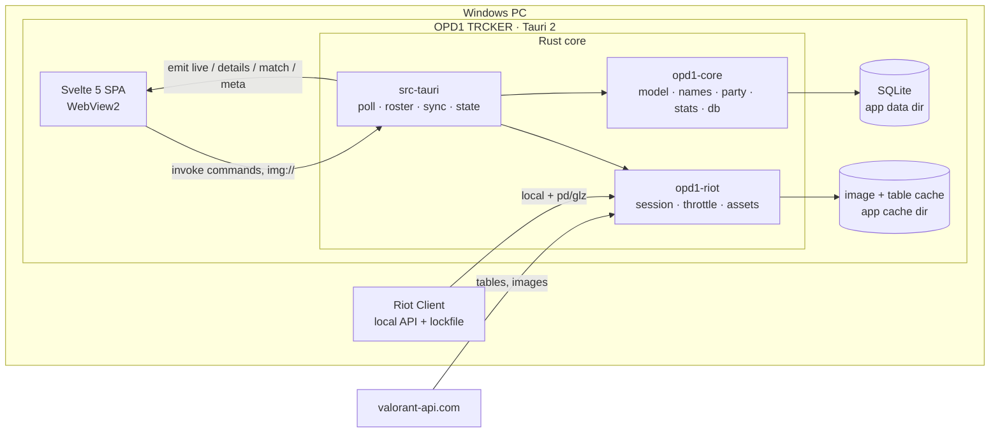

# Architecture

OPD1 TRCKER reads the local Riot client API and shows live Lobby / Agent Select / In Game player cards, plus the user's own competitive stats. Lightness is priority #1 (RAM, CPU, bundle size, request count); design is #2.

Facts on this page come from the code on `main` for v0.2.0 (Phase 2): Match Details, migration 2, the user's own loadout, the own-history backfill, lock-only agent names (R99), the own card's level (R100) the names fill after a match (R150 to R153, migration 3), the rank fallback and bounded rank retry (R154, R155), the Scout-style requests and diagnostics (R158, R159) and the per-family request holds (R160). An interactive diagram of the same system is in [`docs/architecture.html`](architecture.html).

- Product rules: [`CLAUDE.md`](../CLAUDE.md). Every ruling and its status: [`DECISIONS.md`](DECISIONS.md). Build spec for the UI: [`design-spec.md`](design-spec.md).

## Shape of the system



The UI never polls Riot. Rust pushes state with Tauri events, and the UI pulls on demand through commands.

## Crates and responsibilities

| Package (dir) | Owns | Depends on |
|---|---|---|
| `opd1-core` (`crates/core`) | Pure logic, no Tauri and no HTTP, so it is unit-tested on Linux. `lockfile`, `shards` (region from `ShooterGame.log`), `presence` (decode the `/chat/v4/presences` private blob, `Stage`), `model` (wire types `LiveState`, `PlayerCard`, `PlayerDetails`, `build_card`), `names` (`display_name`, hidden-name precedence), `party` (`detect_parties`), `stats` (K/D, HS%, win rate, peak, act labels), `mystats` (My Stats aggregation), `db` (schema, versioned migrations, `Repo`). | `rusqlite` (bundled), `serde` |
| `opd1-riot` (`crates/riot`) | All Riot and valorant-api HTTP. `session::RiotSession` (lockfile, local auth, entitlements, remote headers and `User-Agent`, the client-version chain, token refresh (proactive at 50 minutes, once per call on 401/403 or 400 `BAD_CLAIMS`, R166), `ClientGone`), `throttle` (token bucket), `endpoints` (typed wrappers + `VisiblePuuid`), `assets` (valorant-api tables and the on-disk image cache), `to_core` (Riot responses to core types), `raw_capture` (redaction, log excerpts and the 2xx and error captures for `dump_raw`). | `opd1-core`, `reqwest` (rustls with the `ring` provider, no http3) |
| `opd1-trcker` (`src-tauri`) | The Tauri shell and the app's brain. `poll` (stage machine), `roster` (who is on screen), `sync` (per-player cached-first sync and the background worker), `state` (`AppState`, live model, `publish`), `store` (DB glue), `details` (Player Details), `match_details` (the Match Details command's logic), `commands`, `imgproto` (the `img://` scheme), `logbuf` (ring-buffer log). | both crates, `tauri` |
| `opd1-trcker-ui` (`ui`) | The Svelte 5 + Vite SPA. Its only runtime dependency is `@tauri-apps/api`. | none of the Rust |

## Data flow

The live pipeline is one Tokio task (`poll::start`, launched in `setup`). Its states and transitions:

```text
Disconnected  ── lockfile present → RiotSession::connect (fail → back off 5s…60s) ──► Connected
Connected     ── local presence every 2s (5s while VALORANT is closed)
                 own VALORANT presence absent twice → stage Closed (own card from the DB)
                 sessionLoopState / queueId change → plan_transition()
                    MENUS   → party roster (re-fetched when partyId / partySize change)
                    PREGAME → ally team   (re-polled every 3s only to pick up agent selections, R39)
                    INGAME  → both teams first, then loadouts (R164)
                    PREGAME / INGAME in a free-for-all queue → stays MENUS (R41)
                    INGAME → MENUS = match end: back to Lobby + post-match follow-up
              ── ClientGone / 5 presence errors / VALORANT relaunched under a game-less session ──► Disconnected
```

1. **Poll stage machine (`poll.rs`).** With the lockfile missing, the only idle work is one file check every 5s. A connected session reads the local presence and derives the stage. A stage change fetches the roster (`pregame`, `core-game`, `parties`). A failed roster fetch never leaves the previous stage's players on screen: the new stage is emitted at once with only the user's own card, and the fetch retries every 2s for the first five retries, then with back-off 3s, 6s, 12s, 24s, 30s (R164). Presence can say PREGAME or INGAME a moment before the player endpoint answers. In Game, the roster is applied and the worker started before the core-game loadouts are asked for; a slow or failed loadouts call never delays or fails the roster.
2. **Cached-first cards.** `apply_roster` builds every card from the DB first, so the screen fills immediately. Fields still loading are absent on the wire (the UI draws a skeleton); missing values are `null` (the UI shows `—`) (R23).
3. **Background worker (`sync::run_worker`).** It walks the roster in order (self, party, allies, enemies), syncs one player at a time (see below), and re-publishes after each player. Its job order, decided under the lock in `LiveModel::next_job`, is: names for the live roster, the first-pass syncs, a due rank retry (R155), the names fill (R150), the own-history backfill. It never waits for a retry that is not due yet.
4. **`AppState::publish` → `emit("live")`.** It rebuilds `LiveState` and emits `"live"` only when the serialized bytes differ from the last emission. Build, compare and emit happen under one lock, so events leave in the order the states were built, and an older snapshot can never land after a newer one.
5. **`"details"` event.** `player_details` returns what is cached at once (card, recent matches, top teammates, loadout, encounters). It then syncs that player in the background and emits `"details"` if it found more.
6. **`"match"` event (R150).** `match_details` returns the stored scoreboard at once and records it as the open match (`AppState::open_match`). When the names fill stores names, `match_details::refresh_open` rebuilds that scoreboard from the DB and emits `"match"` (a `MatchDetailsView`, the same shape the command returns) only if the view changed. The UI's Match page calls `close_match(matchId)` when it is left, and Rust then forgets the open match, so nothing is rebuilt or emitted for a page nobody sees. `player_details` clears it too (the UI reaches Player Details from a match only by going Back).
7. **Open-page gates (R163).** `player_details` and `match_details` take a ticket (`AppState::begin_open_details` / `begin_open_match`) before their build and set the open page only if it is still the latest ticket (`set_open_details` / `set_open_match`, checked under the gate lock). A keyed close voids the tickets of its page, so a build that ends after Back, or after a newer open, never re-opens or overwrites a page.
8. **`"meta"` event (R163).** `AppState::ensure_tables` emits `"meta"` (the same `Meta` the `meta` command returns) when the asset tables first load and whenever they were downloaded again, not on a plain version re-check. The UI replaces its names and colours on it, so a table that loaded by another route, or a patch's new ids, reach it without waiting for the UI's own retry.
9. **Post-match.** When a match ends, follow-up checks at about +10s, +20s, +40s, +80s and +160s (each one DB lookup plus the re-sync, stopping at the first success, R164) look at `competitiveupdates` (not the match list) so the rank and RR refresh in the Lobby (R48). The same match end arms the names fill (see below).

## Commands

Registered in `src-tauri/src/lib.rs`, implemented in `commands.rs`:

| Command | Returns |
|---|---|
| `meta` | Agents, maps, tiers and acts from valorant-api (names and colours), fetched once per app start; Rust also pushes them as a `"meta"` event when they load or are refreshed (R163) |
| `live_state` | The current `LiveState` (the UI's first snapshot; later ones arrive as `"live"` events) |
| `player_details` | `PlayerDetails` for one puuid, then a possible `"details"` event |
| `close_details` | Nothing. The UI left Player Details (Back, or another page): the open Details is forgotten, so no `"details"` event is built for it (R149). Takes the optional `puuid` of the page left (R163): a close for another player than the one open or being opened is ignored, and an open still being built for this one is void |
| `my_stats` | `Option<MyStats>` for the user's own account and the current act (`null` until the user and the act are known) |
| `match_details` | `MatchDetailsView` for `(matchId, focusPuuid)`: one match as the Match Details scoreboard (ACS, K/D/A, +/−, ADR, HS%, half scores, each player's rank during the match). Both ids must be uuids. It reads the stored match; a match the DB doesn't have is fetched once from match-details (through the session's throttle), stored like every match, and read again. `Err("unknown match")` when it still isn't there (no session, the fetch failed). Names follow the hidden-name rules below (R74, R93) |
| `close_match` | Nothing; the optional `matchId` of the page left (R163: a close for another match is ignored, and an open still being built for this one is void). The UI left Match Details: the open match is forgotten, so no `"match"` event is built for it. Idempotent (closing with nothing open does nothing), and a later `match_details` opens the slot again. Keyed, so a late close cannot close a newer `match_details` (R150, R163) |
| `copy_log` | The last 500 log lines. The UI writes them to the clipboard with `navigator.clipboard` on Ctrl+Shift+L (bound in `App.svelte`, decided by `keyAction` in `ui/src/lib/boot.ts`, only inside the Tauri shell), so there is no clipboard plugin (R30) |
| `dump_raw` | Writes the redacted raw Riot responses to `debug/` in the app data dir, for fixtures (Ctrl+Shift+D, bound the same way). The dump keeps one body per endpoint, so `match_details.json` is only the last match-details fetched, and `player_loadout.json` is the user's own loadout (R90). Since R158 it also writes `log.txt` (exactly what `copy_log` returns; written even with no session or nothing captured) and, for each endpoint whose last answer was not 2xx, `<key>.error.json` (`{"status", "body"}`) or `<key>.error.txt` (first line `HTTP N`). Error bodies are redacted, cut to 4 KB and have full puuids shortened to 8 characters, and the `*.error.*` files of an earlier dump are removed on each dump so a stale one never blames an endpoint that works now |

## Database

SQLite through `rusqlite` (bundled), in the app data dir (`%APPDATA%\com.opd1.trcker\data\opd1.sqlite` on Windows), WAL mode.

- **Schema.** Migration 1 (`crates/core/src/db/schema.sql`) creates `players`, `matches`, `match_teams`, `match_players`, `history_index`, `comp_updates`, `mmr_snapshots` and `app_state`. Migration 2 (`migration2.sql`, R89) adds four nullable columns for Match Details: `matches.game_length_ms`, `match_teams.rounds_won_h1` (first-half rounds, filled only for the queues with 12-round halves), `match_players.competitive_tier` (the player's rank during the match, R81) and `match_players.damage` (ADR is this over the rounds played). They are `NULL` on rows stored before migration 2. Migration 3 (`migration3.sql`, R150) adds one nullable column, `players.name_asked_ms`, the names fill's blank-answer marker (see below). Match details are stored as compact rows (about 1–2 KB per match), never raw JSON.
- **Migrations.** `db::open_db` applies the entries of `MIGRATIONS` that `PRAGMA user_version` has not seen yet, each in a transaction, and stores the new `user_version` (3 now). An install from v0.1.0 has run migration 1 and takes only migrations 2 and 3. Every change is a new entry appended to the list. Existing entries are frozen, migration 1 included (R89: the `migration1_is_frozen` test fails if `schema.sql` is edited), and there is no self-heal code. The next schema change is migration 4.
- **`app_state`.** A key/value table for small facts the app keeps between runs. Three kinds of key matter here. `self_loadout` is the user's own last-read loadout (R90); it is deleted when a different account connects, so one account's copy never shows for another. `self_history_anchor:{puuid}` is the own-history backfill's anchor (R101) and `self_history_failures:{puuid}` its per-match failure counts (R137, R139). Both are one key per account and are never deleted on an account switch, so switching back finds the first account's anchor again. The pre-R137 single key `self_history_anchor` is no longer read.
- **Keys.** Players are keyed by PUUID, so they are recognised after a name change. Match details are immutable: fetched once, kept forever.
- **Retention.** Keep everything. The DB is the app's memory and survives reinstalls. Only the uninstaller's optional "Delete app data" removes it.

### The user's own loadout (R90)

Another player's skins are readable only from the current match (core-game In Game, pre-game for Agent Select allies), so the Lobby and Closed stages have no source for them. The user's own are different: once per connect, at the first presence that shows VALORANT running (`read_self_loadout_once`), the poll loop spawns `sync::fetch_self_loadout`, one read-only `GET pd .../personalization/v3/players/{self}/playerloadout` (always the user's own puuid; v2 returns 404 on every shard, R148). The four skins (Vandal, Phantom, Operator, Sheriff, in the equipped chroma) are kept in `live.self_loadout` and, only when they changed, in `app_state` under `self_loadout`. At startup the stored copy is restored into `live.self_loadout`, so the user's own Player Details shows their skins while VALORANT is closed. `details::raw_loadout` prefers the match's loadout (the freshest) and falls back to this copy. A connect that never sees VALORANT (the Riot Client alone) asks nothing, and a failure is logged and not retried until the next connect. Skin names come from valorant-api one skin at a time (`/v1/weapons/skins/{uuid}`, never the 3.5 MB `/v1/weapons` table) and the content-tier badges from `/v1/contenttiers`.

### The own-history backfill (R101)

The app was closed while the user played, and Player Details, Encounters and My Stats need those matches, so the user's own history is caught up in the background. It is the lowest-priority job of the sync worker: `LiveModel::next_job` hands out `Names`, then `Sync` (live cards), then a due `RankRetry` (R155), then `FillNames` (the names fill, below), and `Backfill` only when none of them is pending. A step yields as soon as a live job appears, and the run's cursor stays in memory.

- **Trigger.** `sync::start_backfill_run` on connect and again when a match ends (INGAME to MENUS). It is a no-op while a run is active, so a second trigger keeps its cursor. On connect only the run is queued; the worker starts once VALORANT is running, so a Closed start makes no calls (R137).
- **Never during a match.** `LiveModel::backfill_ready` allows a run only in the Lobby or Closed stage and only while the raw presence says no match is on (`in_match`). Agent Select, In Game and a free-for-all match (whose view stays the Lobby, R41) all pause it, and a worker that claimed the job just before a match starts hands it back. The cursor waits in memory and resumes after the match.
- **Walk.** Pages of 20 (`BACKFILL_PAGE`) of the user's match history, any queue. Each page is indexed into `history_index`, and match-details is fetched one at a time (through the throttle) only for ids the DB doesn't know. A match Riot no longer has (404) is skipped at once. Any other failure, a decode error included, ends the run without moving the anchor, so the gap is retried next time. A failure that says something about the id itself (a status other than 401, 403, 404 and 429, or a body that doesn't decode) is counted in `self_history_failures:{puuid}`, and after 3 runs in a row ending at the same id it is skipped and logged. Rate-limit, network and auth errors end the run without counting, so an outage never skips ids for good (R139).
- **Stops.** With an anchor: the anchor's match id, or the first entry older than the anchor's start. First run, no anchor: the start of the current act, or 200 entries (`BACKFILL_FIRST_RUN_MAX`), whichever comes first.
- **Anchor.** When a run finishes with everything stored, the newest entry page 0 showed is written to `app_state` as `self_history_anchor:{puuid}` (`{"matchId", "startMs"}`) and that account's failure counts are cleared. The key belongs to the account that ran, so an account switch can neither delete an anchor nor let one account's anchor bound another's run (R137).

### The names fill (R150 to R153)

Match-details often returns no Riot ID, and Riot blanks a name for anyone who hides it now. The game's own Match History shows the real names after a match, so the app asks name-service, off the live stages only, for the players it has no name for, and keeps the answers by PUUID. One request carries at most 100 puuids (`sync::NAME_BATCH_MAX`, Riot's limit).

- **Triggers.** Each one only queues asks (`LiveModel::queue_name_fill`, one per puuid, at most 300 queued: `NAME_FILL_QUEUE_MAX`); nothing is sent from the trigger itself.
  1. *Match end (main).* `poll` records `match_end_ms` at the raw In Game to Menus change, a Deathmatch included, and clears it when a match starts. `sync::store_details` queues the other players of the stored match whose name match-details left blank, when that match is the one that just ended: the user played in it and it started within 2 hours before the end (`MATCH_END_WINDOW_MS`, `AppState::match_end_asks`). It sits in the shared store path, so it fires whichever path fetched the details first (the post-match sync or the backfill).
  2. *On demand.* `player_details` queues the hero and the Top 3 teammates shown as Missing / Hidden Player / hidden-by-agent (`commands::details_asks`), again after its background details sync. `match_details` queues the rows that have no stored name (`matchview::lacks_stored_name`, who is hidden is not a reason to skip). On-demand asks cover only puuids never asked before.
  3. *Backfill.* The players of the matches a run stores (newest first, one per puuid, at most 200: `BACKFILL_FILL_MAX`) are queued when the run ends by any exit (`sync::end_run`).
- **Worker.** `Job::FillNames` runs behind the live cards and any due rank retry, and ahead of the backfill (`next_job`). `fill_names_step` takes asks off the queue, drops those `Repo::names_to_ask` says are not worth asking (a name is already known, or a blank answer already covers this ask), and sends one `PUT` through the session's throttle. A name is stored in `players` (kind `seen`, R145); a blank answer stores only the marker. After a name arrives, `details::refresh_open` and `match_details::refresh_open` rebuild the open pages. A command cannot start a worker (the poll loop owns its handle), so `AppState::queue_name_fill` sets `worker_kick` and the loop starts one at its next tick, except while Closed (R137).
- **Stage guard (R153).** Nothing is sent while a match is running: Agent Select, In Game, or a Deathmatch (`LiveModel::between_matches`, which reads the raw presence). Asks queued then wait and go out after the match. The guard is checked where asks leave the queue (`take_fill` hands out nothing) and again under the `live` lock right before the request; a match that started in between sends nothing. Players hidden during the match are asked like anyone else; only the user and an empty id never are (`fill_allowed`). The door to name-service is still `VisiblePuuid`. The fill builds it from `(puuid, false)` on purpose, and the stage guard is what makes that claim true. The live-stage lookup (`Job::Names`) passes the real incognito flag and never asks for a hidden player.
- **Asks are kept until answered.** `fill_names_step` holds what it took in a `TakenAsks` drop guard. A step that is dropped (the poll loop aborts the worker on a stage change), or that loses the Riot client (`ClientGone`), puts its asks back in the queue. A failed request (any other error) drops them and stores nothing: an error is not an answer, and the next trigger asks again. An answered request spends them.
- **The marker (migration 3).** `players.name_asked_ms INTEGER`, one ALTER on a row the name lookups already read by primary key (no table, no index; `NAMES_TO_ASK_SQL` is three key seeks per puuid, asserted by a plan test). It is not a wall-clock time and there is no timer: it holds the start of the newest finished match whose question came back blank, or 0 for an on-demand blank, and never goes down. An ask raised by a match is sent only when that match is newer than the marker, so a blank is asked again only at a later match end where the player appears. An on-demand ask is skipped by any marker. A blank answer never erases a name.
- **What shows.** A name learned this way appears later in the remembered style (source `seen`) when that PUUID is hidden on a live roster; off the live screen (Player Details, Match Details) it appears as a plain name. Either answer (a name, or a blank that only sets the marker) creates a `players` row (level 0, no card) for a puuid that had none, so a Player Details opened from a Top 3 row builds an off-screen card with `Lv —` and no card art.

## Caching and sync ("sync, don't refetch")

Per player, `sync::sync_player` does, in order:

1. `comp_updates(0..5)`: one MMR-bucket call gives the last 5 competitive match ids and their RR changes.
2. `match_history(0..2)` in any queue: each player's last two matches, for party detection.
3. `match_details` only for ids not already in the DB (immutable, so never refetched), with at most 4 in flight (`DETAILS_CONCURRENCY`).
4. `mmr` only when `mmr_refresh_needed` says a new competitive match exists. No new competitive match means the rank cannot have changed, so the call is skipped (the MMR gate). When step 1 failed there is no latest match to compare (R160): `mmr` is asked for a player with no stored snapshot (stored with no latest-match id) and skipped when one exists.

A failure other than `ClientGone` is logged and skipped: the fields it would have filled become `—`, never a stuck skeleton. `ClientGone` aborts the run and the poll loop notices the disconnect on its own next tick. The warn line carries the status and Riot's `errorCode` (see "Requests to Riot" below), and the two rank calls have their own remedies:

- **Rank fallback (R154, R161).** MMR is the authority: with a snapshot, the card's rank is the snapshot's (a snapshot that says "no rank this act" included). Without one (`mmr` failed, or has not run), `core::model::rank_without_mmr` takes, in this order: (a) the newest current-act `comp_updates` row whose `tier_after` is a real tier (3 or more): tier and exact RR from `rr_after`; (b) the live tier: the `CompetitiveTier` the pregame (both teams) or party answer carried for the player (`RosterPlayer.live_tier`, `BuildCardInput.live_tier`), a ranked tier only (0 to 2 is none), no act needed, no request: tier only, `rank.rr` is `null`; core-game answers carry no tier, so `poll::fetch_ingame` fills its roster (`roster::fill_tiers`) from `LiveModel::match_tiers`, the tiers of the Agent Select answer bound to its match id and used only when the core-game match id equals it (emptied on a Lobby fetch, on the transition to Menus or Closed and on an account switch); (c) the tier of the newest stored competitive match (`Repo::newest_ranked_match_tier`, one indexed query on `idx_match_players_puuid`, loaded by `store::load_player_db` only for a player with no snapshot) when that match started in the current act: tier only, `rank.rr` is `null` and the UI shows `— RR`; (d) otherwise the rank stays missing. Nothing but the current rank falls back: Peak, Prev, Win% and Games wait for MMR. The card, the Player Details hero, the off-screen card and the Closed-stage own card all go through `card_for`, so they share it.
- **Bounded retry (R155).** A sync whose `comp_updates` or `mmr` call failed (`SyncOutcome.rank_failed`, any error but `ClientGone`) is run again by `Job::RankRetry`: the first retry no sooner than 20 s after the failure, the second no sooner than 60 s after the first retry failed, then never again for that first pass (3 syncs at most; `src-tauri/src/rank_retry.rs`, a pure schedule that takes the time as an argument). A rank part that only met the mmr hold (`SyncOutcome.rank_held`, `RiotError::Held`: nothing was sent, R160) is not a failure and uses no retry: `LiveModel::note_rank_held` makes the player due 1.5 s after the hold ends (`RankRetries::first_pass_held`, `retry_held`). A retry is counted when it is handed out, so one cut short by a stage change still uses its turn, and a retry never starts a round of its own. Only a player still on the live roster is retried (`LiveModel::prune_rank_retries` after a roster change), never while the stage is Closed, and an account switch clears the schedule. The worker exits when nothing is due; the poll loop's tick (every 2 s while VALORANT runs) starts one when a retry comes due. Tests move time with a `#[cfg(test)]` offset on `LiveModel::now`, not real sleeps. A later MMR answer replaces the fallback.

- **Current act (R162).** `AppState::acts()` is the one table every "current act" and "previous act" reads. At the first presence that shows VALORANT (never while the game is closed) the poll loop asks Riot's `shared.{shard}.a.pvp.net/content-service/v3/content` (one call, global bucket) for the `act` entry with `IsActive` and the act whose `EndTime` is its `StartTime`; `roster::resolve_acts` folds that into valorant-api's list (Riot's id, start and end; valorant-api's names, else Riot's `Name`s with the episode found by time; later acts dropped). Riot's answer is used until the act's end passes, then valorant-api's date rule answers until Riot is asked again; a failure logs one line and keeps an earlier answer whose act has not ended, else leaves the date rule. Nothing outside `AppState` applies the date rule to the raw table.

Assets come from valorant-api. The tables (agents, tiers, maps, seasons, chromas, cards) are re-downloaded only when `/v1/version` changes, and images are downloaded once and cached on disk (re-encoded to PNG).

## Party detection

`opd1_core::party::detect_parties` (R53, R55) uses each player's last two matches in any mode, Deathmatch included, straight from the DB with no extra requests.

- Two players on the same team whose most recent match is the same match are a **likely** party (Deathmatch has no teams, so the same match is enough).
- The link is **confirmed** when both last matches are shared, or when the shared most recent match gives both the same non-empty `partyId`.
- Links are transitive (A–B plus B–C is one group), and a group is confirmed only if every link inside it is.
- The user and their own party are excluded entirely, including as a bridge. Opposite teams in the current match are never linked. Marks come only from history synced in this session, so a stripe can appear a few seconds after its card.

## Hidden names

Rules in `CLAUDE.md` "Hidden names". How the code enforces them in v0.2.0.

- **Type-level guard (R16).** `endpoints::names()` accepts only `VisiblePuuid`, a newtype built from `(puuid, incognito = false)`. A hidden player's name cannot be requested during a live stage by construction: the live-stage lookup builds it from the real flag. The names fill builds it between matches for players who hid during the match (R153), and its stage guard, not the type, keeps it out of Agent Select and In Game.
- **Precedence (`names::display_name`).** Visible, else the remembered name, else the agent name, else `Hidden Player`. During live stages a hidden player's remembered name comes from any source the DB knows: a match the user played, another stored match, or a name-service answer from when the player was visible (`RememberedSource`: `ownMatch`, `otherMatch`, `seen`; R145). A live-incognito player's name is never requested (R16, R150, R153); their rank, stats and history are fetched like anyone's. An agent counts as shown only once it is locked (`model::shown_agent`: `CharacterSelectionState == "locked"`, R99), so a hover shows nothing. Core-game players have no such field and are passed as `"locked"` by the roster code.
- **The user's own card** shows the user's own name from the local `/chat/v1/session` and never goes to name-service (R43, R49). Other players with `HideAccountLevel` (or a level of 0) show `Lv —`, but the own card always shows the user's own level (R100, `state.rs`: the flag is ignored for the user).
- **Match Details (R74, R93).** `opd1_core::matchview::build_match_view` picks each row's name in this order: the user's own name; a puuid hidden on the live screen now shows as its card does (the remembered name from `Repo::known_name`, which reads any source, newest first, else the agent name, else `Hidden Player`), in every view; otherwise a stored name as match-details gave it; a row with no stored name shows the players-table name when it is not hidden now, else the hidden-style result. R150 lets the app ask name-service, off the live stages only, for match participants with no known name (batched, throttled, cached in `players`; see the names fill above); Riot blanks anyone who currently hides, so no hidden name is revealed. Opening a match queues the names its rows lack and the page is rebuilt when they arrive (the `"match"` event).

## Requests to Riot (R158, R159)

Built the way Valorant-Scout builds them (`riot_client.py`).

- **Client version (R159, supersedes R17).** `session::fetch_client_version`, run once in `connect()`, takes the first usable value of: the user's own VALORANT presence `partyClientVersion` (under `partyPresenceData`, else flat), valorant-api `/v1/version` `riotClientVersion`, the `CI server version:` line of `ShooterGame.log` (`core::shards::parse_client_version`, on the text already read for the shards), and the literal `release-09.00`. An empty, whitespace-only or unsendable (control characters, non-ASCII) value is no answer and falls through. `/product-session/v1/external-sessions` is never asked. The version and its source (`presence`, `valorant-api`, `log`, `fallback`) are logged once per session at info.
- **Re-resolve.** A session built before the game's presence existed has a lower source. At the first VALORANT presence tick the poll loop passes the `private` blob it already read to `RiotSession::note_presence_version`, which replaces the header value with the presence's version and logs the change once. No request is made. A presence without a usable version leaves the lower value in place and is tried again on the next tick (`client_version_from_presence_once`); once the source is the presence, it is done.
- **`User-Agent`.** Every remote (pd/glz) call sends `ShooterGame/13 Windows/10.0.19043.1.256.64bit` (`REMOTE_USER_AGENT`). Local calls send none.
- **gzip.** On for the remote client (pd/glz, and the valorant-api version fetch, which shares it) and for the two asset clients (`assets.rs`, valorant-api tables and images); off for the local client (`.no_gzip()`: with reqwest's `gzip` feature every client asks for it by default, and on `127.0.0.1` compression only costs CPU). reqwest decodes before the body is buffered, so captures, parsing and error excerpts see plain JSON.
- **Failed calls (R158).** `RiotError::Status(u16, String)` carries a log-safe excerpt of Riot's answer (`raw_capture::excerpt`: secret-named keys and JWT-shaped strings redacted, including a JWT quoted inside a longer string, JSON on one line, full uuids shortened to 8 characters, at most 200 characters; the same redaction covers the 2xx captures, so a token embedded in a string never reaches a file). Its `Display` is `unexpected HTTP status N from Riot: <excerpt>`, so every warn line that prints the error (sync, match-details, backfill, names fill) shows the `errorCode`. Transport and decode errors name their kind (`timeout`, `connect`, `body`, `decode`, `request`, `builder`, `other`). Both choke points (`call_local`, `call_remote`) record the last non-2xx answer per endpoint key in `RawCaptures`, a store apart from the 2xx captures, for the dump files above. Match a `Status(code, _)` with the two-field form.
- **Token freshness (R166).** `AuthState` holds the access token and entitlements JWT with a `generation` and the time they were fetched. `RiotSession::remote` first calls `refresh_if_stale` (token older than `TOKEN_MAX_AGE`, 50 minutes: fetch `/entitlements/v1/token` from the local client; on failure go on with the cached token and wait `PROACTIVE_RETRY_PAUSE` before trying again), and after a response `token_rejected` (401, 403, or 400 with `errorCode == "BAD_CLAIMS"`) triggers `refresh_entitlements_after(generation)` and one repeat of the call (`reauthed`: at most once per call). `refresh_entitlements_after` takes `refresh_gate` and returns at once if the generation moved since the caller read it, so concurrent rejected calls share one fetch.
- **Tolerant decoding (R166).** `endpoints.rs` structs never fail on a missing or `null` non-identity field: `null_to_default` for scalars and plain lists, `lenient_list` (drops elements that do not decode, so an element without its identity is gone), `lenient_opt` and `lenient_map` for objects and maps; `whole_list` (empty when missing or `null`, but any element that does not decode fails the answer) for match history, competitive updates and a match's `teams`, and a plain `Vec` for a match's `players`. `RiotSession::match_details` also fails a competitive, unrated or premier answer (not a `VoteDraw`) whose `teams` is empty or has more than one winner (`check_winner`), so it is retried instead of stored; both teams `won: false` is a draw (R29) and is accepted. `PlayerIdentity` decodes through a raw shape and fails closed (hidden when `Incognito` did not arrive). `tests/tolerant_decoding.rs` runs each field as absent and as `null`. `RiotSession::names` retries a 5xx or transport error once and reads its answer through the same lenient list.

## The `img://` scheme and throttling

- **`img://` (R11, R21).** A Tauri custom URI scheme (`http://img.localhost/<kind>/<id>` on Windows). `imgproto::serve` returns the disk-cached file or downloads it once, lazily. The kinds are agent, cardSmall, cardWide, cardLarge, tier, mapList, mapSplash, chroma and contentTier (the skin edition badges). Every image in the UI goes through it, so the CSP stays strict and the UI never sees an absolute path.
- **Throttling.** Every remote (pd/glz) call takes a token from a global bucket (burst 10, 10 requests per second), and MMR calls also take from their own slower bucket (burst 24, 0.4 per second). A `429` puts a hold on its request family for the full `Retry-After` (R160; a 120 s ceiling guards against a garbage header, `throttle::MAX_HOLD_SECS`). There are two families, `mmr` (pd paths starting `/mmr/`) and `other`, each with its own `throttle::Hold`; the buckets stay shared. An `other` call waits in the call only for a hold of at most 10 s (`OTHER_MAX_WAIT`) and is retried at most twice; with more than 10 s left it returns `Held` at once, and a 429 whose hold comes to more than 10 s returns `RateLimited` at once instead of sleeping (the callers treat both as "not now": R160). A name-service call refused that way defers the names jobs (`LiveModel::defer_names`); the poll tick starts a worker once when the deferral runs out and names or fill asks are waiting (`names_wakeup_due`), and a new session clears it. An mmr call during the mmr hold returns `RiotError::Held(remaining)` at once with nothing sent, and an mmr 429 sets the hold and returns `RateLimited` with no in-call retry, so the sync worker is never parked by Riot's ~60 s `/mmr/` block. Each hold started logs one line (family, seconds, path with ids shortened). The design follows Valorant-Scout's `riot_client.py`.

## Build and release

GitHub Actions (`windows-latest`, workflow `Build`) builds the UI, runs the Rust tests, the UI tests and `npm --prefix ui run check`, then `npx tauri build`. Two guards run after it: a grep of `ui/dist` fails the build on demo code (`demo-feed`, the fixture-only names `VesperUnbreakabl` and `Vantablack`) or a CDN reference (`fonts.googleapis`, `fonts.gstatic`, `unpkg.com`), and the installer must be at most 10 MB (10485760 bytes). The NSIS installer is then uploaded as the `OPD1-TRCKER-setup` artifact. The build is unsigned, per-user, and shared by hand. The installer removes the previous program files, settings and image cache, and keeps the DB. `THIRD-PARTY-NOTICES.md` is bundled with it as a resource (R109).

The release profile (`Cargo.toml`) is `opt-level = "s"`, `lto`, `codegen-units = 1` and `strip`, for the smallest installer and the lowest RAM. Panics keep unwinding (R138, no `panic = "abort"`): a panic in a poll, sync or details task is caught by its `JoinSet` and logged as "task failed", and the R97 skin-resolve drop guard still runs, so one stray panic does not end the tracker mid-match. It costs about 200 KB of installer.
