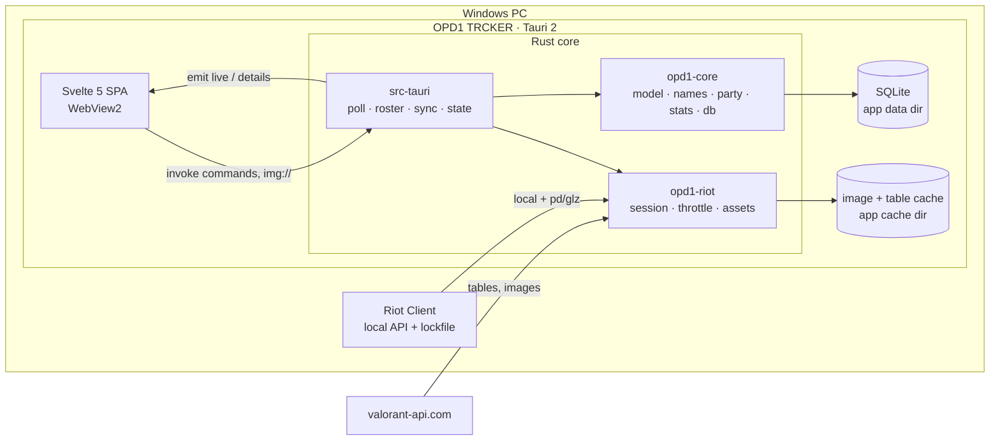

# Architecture

OPD1 TRCKER reads the local Riot client API and shows live Lobby / Agent Select / In Game player cards, plus the user's own competitive stats. Lightness is priority #1 (RAM, CPU, bundle size, request count); design is #2.

Facts on this page come from the code on `main` at the end of Phase 1 (`c9ad7f4`). Phase 2 adds Match Details, migration 2, the user's own loadout and the own-history backfill. Task 19 (release) records those here once their lanes have landed. An interactive diagram of the same system is in [`docs/architecture.html`](architecture.html).

- Product rules: [`CLAUDE.md`](../CLAUDE.md). Every ruling and its status: [`DECISIONS.md`](DECISIONS.md). Build spec for the UI: [`design-spec.md`](design-spec.md).

## Shape of the system



The UI never polls Riot. Rust pushes state with Tauri events, and the UI pulls on demand through commands.

## Crates and responsibilities

| Package (dir) | Owns | Depends on |
|---|---|---|
| `opd1-core` (`crates/core`) | Pure logic, no Tauri and no HTTP, so it is unit-tested on Linux. `lockfile`, `shards` (region from `ShooterGame.log`), `presence` (decode the `/chat/v4/presences` private blob, `Stage`), `model` (wire types `LiveState`, `PlayerCard`, `PlayerDetails`, `build_card`), `names` (`display_name`, hidden-name precedence), `party` (`detect_parties`), `stats` (K/D, HS%, win rate, peak, act labels), `mystats` (My Stats aggregation), `db` (schema, versioned migrations, `Repo`). | `rusqlite` (bundled), `serde` |
| `opd1-riot` (`crates/riot`) | All Riot and valorant-api HTTP. `session::RiotSession` (lockfile, local auth, entitlements, remote headers, re-auth on 401/403, `ClientGone`), `throttle` (token bucket), `endpoints` (typed wrappers + `VisiblePuuid`), `assets` (valorant-api tables and the on-disk image cache), `to_core` (Riot responses to core types), `raw_capture` (for `dump_raw`). | `opd1-core`, `reqwest` (rustls with the `ring` provider, no http3) |
| `opd1-trcker` (`src-tauri`) | The Tauri shell and the app's brain. `poll` (stage machine), `roster` (who is on screen), `sync` (per-player cached-first sync and the background worker), `state` (`AppState`, live model, `publish`), `store` (DB glue), `details` (Player Details), `commands`, `imgproto` (the `img://` scheme), `logbuf` (ring-buffer log). | both crates, `tauri` |
| `opd1-trcker-ui` (`ui`) | The Svelte 5 + Vite SPA. Its only runtime dependency is `@tauri-apps/api`. | none of the Rust |

## Data flow

The live pipeline is one Tokio task (`poll::start`, launched in `setup`). Its states and transitions:

```text
Disconnected  ── lockfile present → RiotSession::connect (fail → back off 5s…60s) ──► Connected
Connected     ── local presence every 2s (5s while VALORANT is closed)
                 own VALORANT presence absent twice → stage Closed (own card from the DB)
                 sessionLoopState / queueId change → plan_transition()
                    MENUS   → party roster (re-fetched when partyId / partySize change)
                    PREGAME → ally team   (re-polled every 3s only to pick up agent locks, R39)
                    INGAME  → both teams + loadouts
                    PREGAME / INGAME in a free-for-all queue → stays MENUS (R41)
                    INGAME → MENUS = match end: back to Lobby + post-match follow-up
              ── ClientGone / 5 presence errors / VALORANT relaunched under a game-less session ──► Disconnected
```

1. **Poll stage machine (`poll.rs`).** With the lockfile missing, the only idle work is one file check every 5s. A connected session reads the local presence and derives the stage. A stage change fetches the roster (`pregame`, `core-game`, `parties`). A failed roster fetch never leaves the previous stage's players on screen: the new stage is emitted at once with only the user's own card, and the fetch retries with back-off.
2. **Cached-first cards.** `apply_roster` builds every card from the DB first, so the screen fills immediately. Fields still loading are absent on the wire (the UI draws a skeleton); missing values are `null` (the UI shows `—`) (R23).
3. **Background worker (`sync::run_worker`).** It walks the roster in order (self, party, allies, enemies), syncs one player at a time (see below), and re-publishes after each player.
4. **`AppState::publish` → `emit("live")`.** It rebuilds `LiveState` and emits `"live"` only when the serialized bytes differ from the last emission. Build, compare and emit happen under one lock, so events leave in the order the states were built, and an older snapshot can never land after a newer one.
5. **`"details"` event.** `player_details` returns what is cached at once (card, recent matches, top teammates, loadout, encounters). It then syncs that player in the background and emits `"details"` if it found more.
6. **Post-match.** When a match ends, follow-up checks at +30s and +90s look at `competitiveupdates` (not the match list) so the rank and RR refresh in the Lobby (R48).

## Commands

Registered in `src-tauri/src/lib.rs`, implemented in `commands.rs`:

| Command | Returns |
|---|---|
| `meta` | Agents, maps, tiers and acts from valorant-api (names and colours), fetched once per app start |
| `live_state` | The current `LiveState` (the UI's first snapshot; later ones arrive as `"live"` events) |
| `player_details` | `PlayerDetails` for one puuid, then a possible `"details"` event |
| `my_stats` | `Option<MyStats>` for the user's own account and the current act (`null` until the user and the act are known) |
| `copy_log` | The last 500 log lines. The UI writes them to the clipboard on Ctrl+Shift+L, so there is no clipboard plugin (R30) |
| `dump_raw` | Writes the redacted raw Riot responses to `debug/` in the app data dir, for fixtures |

Task 19 adds `match_details` here once lane B has landed.

## Database

SQLite through `rusqlite` (bundled), in the app data dir (`%APPDATA%\com.opd1.trcker\data\opd1.sqlite` on Windows), WAL mode.

- **Schema.** Migration 1 (`crates/core/src/db/schema.sql`) creates `players`, `matches`, `match_teams`, `match_players`, `history_index`, `comp_updates`, `mmr_snapshots` and `app_state`. Match details are stored as compact rows (about 1–2 KB per match), never raw JSON.
- **Migrations.** `db::open_db` applies the entries of `MIGRATIONS` that `PRAGMA user_version` has not seen yet, each in a transaction, and stores the new `user_version`. Every change is a new entry appended to the list. Existing entries are frozen, migration 1 included (R89), and there is no self-heal code.
- **Keys.** Players are keyed by PUUID, so they are recognised after a name change. Match details are immutable: fetched once, kept forever.
- **Retention.** Keep everything. The DB is the app's memory and survives reinstalls. Only the uninstaller's optional "Delete app data" removes it.

Task 19 adds migration 2 (R89), the user's own loadout (R90) and the own-history backfill (R101) to this section, because lane A owns `docs/` while lane B runs.

## Caching and sync ("sync, don't refetch")

Per player, `sync::sync_player` does, in order:

1. `comp_updates(0..5)`: one MMR-bucket call gives the last 5 competitive match ids and their RR changes.
2. `match_history(0..2)` in any queue: each player's last two matches, for party detection.
3. `match_details` only for ids not already in the DB (immutable, so never refetched), with at most 4 in flight (`DETAILS_CONCURRENCY`).
4. `mmr` only when `needs_mmr_refresh` says a new competitive match exists. No new competitive match means the rank cannot have changed, so the call is skipped (the MMR gate).

A failure other than `ClientGone` is logged and skipped: the fields it would have filled become `—`, never a stuck skeleton. `ClientGone` aborts the run and the poll loop notices the disconnect on its own next tick.

Assets come from valorant-api. The tables (agents, tiers, maps, seasons, chromas, cards) are re-downloaded only when `/v1/version` changes, and images are downloaded once and cached on disk (re-encoded to PNG).

## Party detection

`opd1_core::party::detect_parties` (R53, R55) uses each player's last two matches in any mode, Deathmatch included, straight from the DB with no extra requests.

- Two players on the same team whose most recent match is the same match are a **likely** party (Deathmatch has no teams, so the same match is enough).
- The link is **confirmed** when both last matches are shared, or when the shared most recent match gives both the same non-empty `partyId`.
- Links are transitive (A–B plus B–C is one group), and a group is confirmed only if every link inside it is.
- The user and their own party are excluded entirely, including as a bridge. Opposite teams in the current match are never linked. Marks come only from history synced in this session, so a stripe can appear a few seconds after its card.

## Hidden names

Rules in `CLAUDE.md` "Hidden names". How the code enforces them:

- **Type-level guard (R16).** `endpoints::names()` accepts only `VisiblePuuid`, a newtype built from `(puuid, incognito = false)`. A hidden player's name cannot be requested by construction.
- **Precedence (`names::display_name`).** Visible, else the remembered name, else the agent name (only once the agent is locked, R99), else `Hidden Player`. Remembered names are learned only from finished matches the user played, and never from another player's history (R18).
- **The user's own card** shows the user's own name from the local `/chat/v1/session` and never goes to name-service (R43, R49). The own account level also shows always (R100).
- **Match Details (R74, R93).** match-details has no incognito flag, so in a match the user did not play, a row shows as its agent name (or the remembered name) when its puuid is incognito on the live screen now or its stored name is empty. The first real test confirms whether Riot hides those names (R94).

## The `img://` scheme and throttling

- **`img://` (R11, R21).** A Tauri custom URI scheme (`http://img.localhost/<kind>/<id>` on Windows). `imgproto::serve` returns the disk-cached file or downloads it once, lazily. The kinds are agent, cardSmall, cardWide, tier, mapList, mapSplash and chroma. Every image in the UI goes through it, so the CSP stays strict and the UI never sees an absolute path.
- **Throttling.** Every remote (pd/glz) call takes a token from a global bucket (burst 10, 10 requests per second), and MMR calls also take from their own slower bucket (burst 24, 0.4 per second). A `429` puts a hold on the throttle for `Retry-After`, clamped to 0–30s (R26), and a call is retried at most twice. The design follows Valorant-Scout's `riot_client.py`.

## Build and release

GitHub Actions (`windows-latest`, workflow `Build`) runs the Rust and UI tests, then `npx tauri build`, and uploads the NSIS installer as the `OPD1-TRCKER-setup` artifact. The build is unsigned, per-user, and shared by hand. The installer removes the previous program files, settings and image cache, and keeps the DB.
